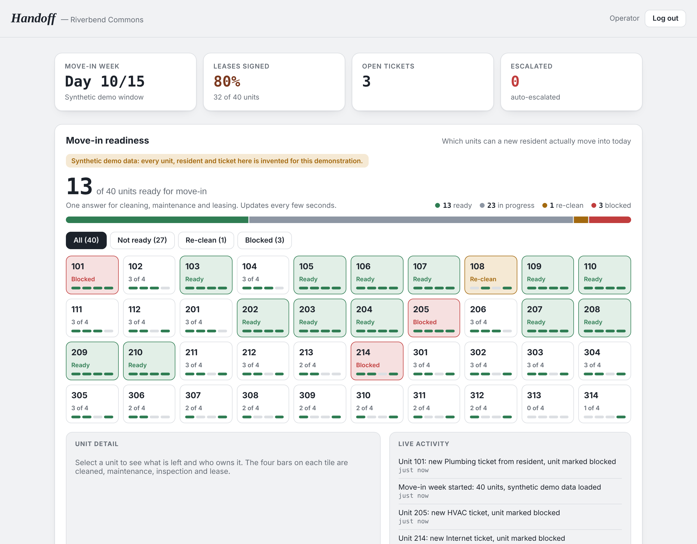

# Handoff

**One live board that answers "is this unit ready for move-in?"**

[Watch the 1-minute demo video](https://youtu.be/kwUmdrw1GMs) · [Try the live prototype](https://handoff-app-production-6ee2.up.railway.app) · Built for ENTR 5000, University of Georgia

*Every unit, resident and ticket in the prototype is invented demo data. The prototype demonstrates an idea. It does not show that operators want it or would pay for it.*

## The opportunity

At student-housing properties, almost every lease turns over in the same two or three weeks each August. Cleaning, maintenance, inspection and leasing all have to finish in that window, and a resident can't move in until all four are done.

I started on this because I watched a small property fall behind during that window. When I talked with leasing staff at larger properties, one described the hard part as the physical work and the coordination between teams, not the software. His example was a unit people believed was cleaned that had not been cleaned properly. That is a readiness problem, and it is the problem Handoff now focuses on.

## What I built

Handoff is a working web app with an operator view and a resident view.

- **Readiness board.** Each unit shows four checks: cleaned, maintenance cleared, inspected, lease signed. A unit is **Ready** only when all four are done and the resident has no open problem. The board updates every few seconds.
- **Failed inspections go back automatically.** If an inspector fails a unit ("oven not cleaned"), it returns to cleaning and the crew is notified.
- **Residents report problems in plain language.** A report like "water is leaking under my sink" is routed to a plumber and blocks that unit's readiness until it is resolved. Residents see their own unit's status.
- **Leases.** The app drafts a PDF lease from unit data and tracks who has signed.

It is a full-stack app (Express, SQLite, plain JavaScript) deployed on Railway. Some parts are stand-ins: issue routing uses keyword rules, not an AI model, and e-signature is simulated. The technical details are in [docs/TECHNICAL.md](docs/TECHNICAL.md).

## What I learned

My original idea was an AI tool for lease tracking and issue triage. Conversations with operators changed it.

- The operators I spoke with use Entrata and were generally happy with it. "Software that tracks leases" is not an open gap, and I stopped treating it as one.
- At a large property, a leasing agent said the friction is coordination: who has finished what, and whether it was done properly. That is one voice, but it is why the product moved from lease tracking toward readiness.
- A property manager at a small operator did not name a specific August pain, was not interested in a demo, and said the owner makes software decisions. That is one conversation, so it is a single data point, not a finding. It does show that the person I talk to may not be the person who decides.

## What is validated and what is not

| Demonstrated | Not yet validated |
|---|---|
| The readiness logic works end to end in a live prototype | That small operators feel this pain strongly |
| A leasing agent at a large property described the same coordination gap | That a small operator would switch or pay |
| The app is deployed and usable by anyone with the demo logins | Who the actual buyer is (owner or manager) |

## Next step

The next test is small. I want to show the readiness board to an owner or decision-maker at a small operator and ask how they currently know a unit is ready. If "we check and it's fine" is the honest answer, the idea is weaker than I think. If they describe unclear handoffs between cleaning, maintenance and leasing, the next step is a pilot on one turnover cycle with real units.

## Try it

- **Live:** https://handoff-app-production-6ee2.up.railway.app
- **Operator login:** `operator@handoff.demo` / `handoff123`
- **Resident codes:** `MAYA-101`, `DEVON-102`, `PRIYA-201`, `SAM-214`
- Use two different browsers (or a phone) for operator and resident, because they share a login cookie.
